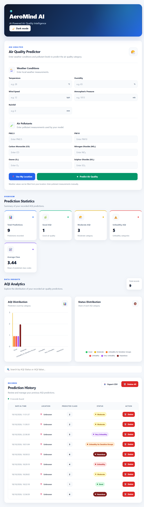
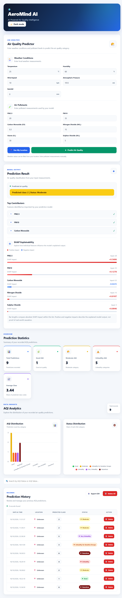

# 🌦️ AeroMind AI — Air Quality Prediction

AeroMind AI is a machine-learning web application that predicts air-quality categories from weather and pollutant measurements. It combines a React frontend, FastAPI backend, machine-learning models, MySQL integration, and SHAP-based feature explanations.

## 📌 Project Overview

Air quality is influenced by environmental factors such as temperature, humidity, wind conditions, and pollutant concentrations.

AeroMind AI uses machine learning to estimate air-quality categories from supported environmental measurements. The project brings together data analysis, model development, explainable AI, and full-stack application development.

**Note:** Predictions are estimates for educational and analytical purposes. They are not official environmental measurements or medical advice.

## 🎯 Objectives

- Analyze weather and pollutant measurements relevant to air quality.
- Develop machine-learning models for air-quality classification.
- Integrate a trained model with a FastAPI backend.
- Build a React interface for submitting measurements and viewing predictions.
- Use SHAP to explain feature contributions to model predictions.
- Store and review prediction history using MySQL.
- Provide interactive visualizations and CSV export functionality.

## ✨ Features

- **Air Quality Prediction:** Predict an air-quality category from supported input features.
- **Environmental Inputs:** Submit weather and pollutant measurements through the frontend.
- **Explainable AI:** Explore SHAP-based feature contribution explanations.
- **Prediction History:** Review previously recorded predictions.
- **CSV Export:** Export prediction history for further analysis.
- **Interactive Dashboard:** Explore predictions and history through charts and interface controls.
- **Full-Stack Integration:** Connect the frontend, backend, machine-learning model, and database.

## 🛠️ Technology Stack

| Component | Technologies |
|---|---|
| Frontend | React, Chart.js |
| Backend | Python, FastAPI, Uvicorn |
| Machine Learning | scikit-learn, NumPy, SciPy |
| Explainable AI | SHAP |
| Database | MySQL, MySQL Connector |
| Data Analysis | Pandas, Matplotlib, Seaborn |
| Configuration | python-dotenv |
| Dataset | Global Weather Repository dataset |

## 📂 Project Structure

```text
AeroMind-AI/
├── backend/
│   ├── main.py
│   └── requirements.txt
├── dataset/
│   └── GlobalWeatherRepository.csv
├── frontend/
│   ├── package.json
│   └── src/
├── models/
│   └── aqi_model.pkl
├── notebooks/
├── screenshots/
│   ├── dashboard.png
│   └── prediction_result.png
├── .gitignore
└── README.md
```

*This is a representative project structure. The exact files and directories may vary. Add the screenshot files before using the image references below.*

## 🔍 Project Workflow

1. **Data Preparation:** Load and prepare weather and pollutant data for analysis.
2. **Exploratory Data Analysis:** Examine environmental measurements and their relationships with air-quality categories.
3. **Model Development:** Train and evaluate classification models.
4. **Model Integration:** Load the trained model in the FastAPI backend.
5. **Prediction:** Receive supported environmental measurements and return a predicted category.
6. **Explainability:** Use SHAP to examine feature contributions to predictions.
7. **Frontend Integration:** Display predictions, explanations, and history through the React interface.
8. **History Management:** Store and retrieve prediction records using MySQL and support CSV export.

## 🤖 Machine Learning

The project explores several classification algorithms:

- Random Forest
- Logistic Regression
- Decision Tree
- XGBoost

The project structure identifies `models/aqi_model.pkl` as the saved model path. Confirm that this file exists and that the backend loads the intended model before publishing.

### Air Quality Categories

The application works with these categories:

- Good
- Moderate
- USG (Unhealthy for Sensitive Groups)
- Unhealthy
- Very Unhealthy
- Hazardous

The model's actual input features, class definitions, and prediction behavior depend on its training pipeline.

## 🧠 Explainable AI with SHAP

AeroMind AI uses **SHAP (SHapley Additive exPlanations)** to help interpret model predictions.

SHAP explanations can indicate which input features contributed positively or negatively to a prediction. They explain the behavior of the trained model and do not establish causal relationships between environmental factors and air quality.

## 📸 Screenshots

### Dashboard



### Air Quality Prediction and SHAP Explainability



*Place the actual image files in the `screenshots/` directory. If you do not have these screenshots yet, remove the two image references until the files are available.*

## ⚙️ Setup and Installation

### Prerequisites

Install the following:

- Python
- Node.js and npm
- Git
- MySQL, if using database-backed history features

### 1. Clone the Repository

```bash
git clone https://github.com/sohamdinda/AeroMind-AI.git
cd AeroMind-AI
```

This command assumes your GitHub repository is named `AeroMind-AI` under the `sohamdinda` account.

### 2. Set Up the Backend

Run these commands from the project root in Windows PowerShell.

Create a virtual environment:

```powershell
python -m venv backend\.venv
```

Activate it:

```powershell
.\backend\.venv\Scripts\Activate.ps1
```

Install the dependencies listed in `backend/requirements.txt`:

```powershell
python -m pip install -r backend\requirements.txt
```

Start the API from the backend directory:

```powershell
cd backend
uvicorn main:app --reload
```

The API should be available at:

- API: `http://127.0.0.1:8000`
- Interactive API documentation: `http://127.0.0.1:8000/docs`

These commands assume `backend/main.py` exposes a FastAPI instance named `app`.

### 3. Set Up the Frontend

Open a **second terminal** from the project root.

Navigate to the frontend directory:

```powershell
cd frontend
```

Install the dependencies:

```powershell
npm install
```

Start the React development server:

```powershell
npm start
```

With the standard Create React App setup, the frontend is available at:

`http://localhost:3000`

For a production build, run:

```powershell
npm run build
```

### 4. Configure the Database

Configure the MySQL connection using the settings expected by the backend.

- Ensure the MySQL server is running if the application uses database-backed features.
- Configure the database name, username, password, and connection settings as required by the backend.
- Keep credentials in environment variables or a local configuration file excluded from Git.

### 5. Verify the Model and Dataset

Confirm that the model and any required dataset files exist at the paths expected by the application. Obtain datasets from authorized sources.

## ⚠️ Limitations

- Predictions depend on the quality, coverage, and representativeness of the training data.
- Performance on new locations, time periods, weather conditions, and monitoring systems requires validation.
- SHAP explains model behavior but does not prove causality.
- Predictions must not replace official air-quality measurements or professional health guidance.
- Database configuration and local file paths may require environment-specific adjustments.
- Dataset and model redistribution permissions should be checked before sharing them.

## 🚀 Future Improvements

- Evaluate model generalization across different locations and time periods.
- Validate predictions against reliable air-quality monitoring measurements.
- Report class-wise precision, recall, F1-score, and confusion matrices.
- Improve SHAP visualizations and explanation consistency.
- Add stronger API input validation and error handling.
- Improve database configuration and deployment security.
- Add automated tests and deployment documentation.
- Explore reliable live weather and air-quality data integration.

## 🔐 Security

- Never commit `.env` files, passwords, database credentials, or API keys.
- Exclude virtual environments, caches, and sensitive local files from version control.
- Validate incoming API inputs.
- Use appropriate database access controls.
- Review dataset and model redistribution permissions before publishing.

## 📄 License

No license has been specified. Add an appropriate license before allowing others to reuse or redistribute the project.

## 👨‍💻 Author

**Soham Dinda**

GitHub: [@sohamdinda](https://github.com/sohamdinda)

---

*This project is intended for educational and analytical purposes. It is not a substitute for official environmental monitoring or professional health advice.*